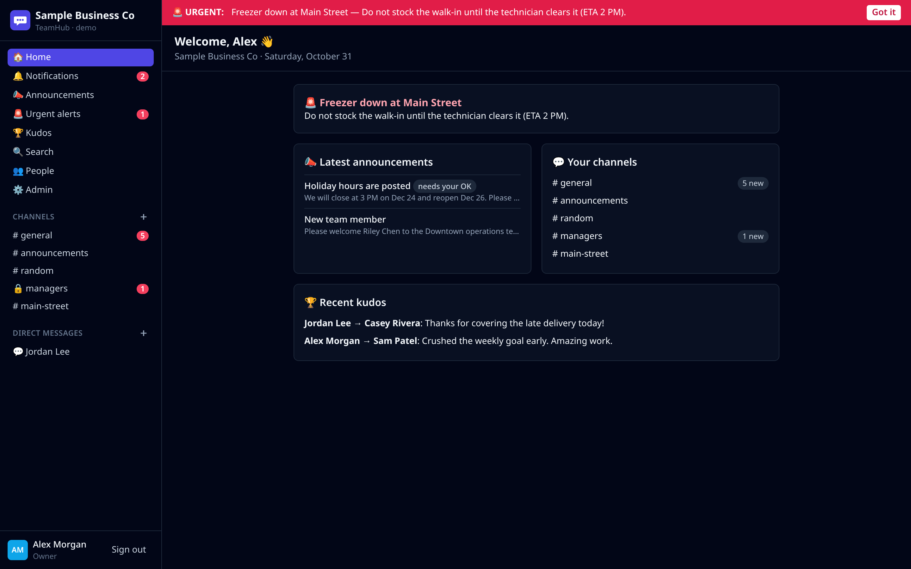
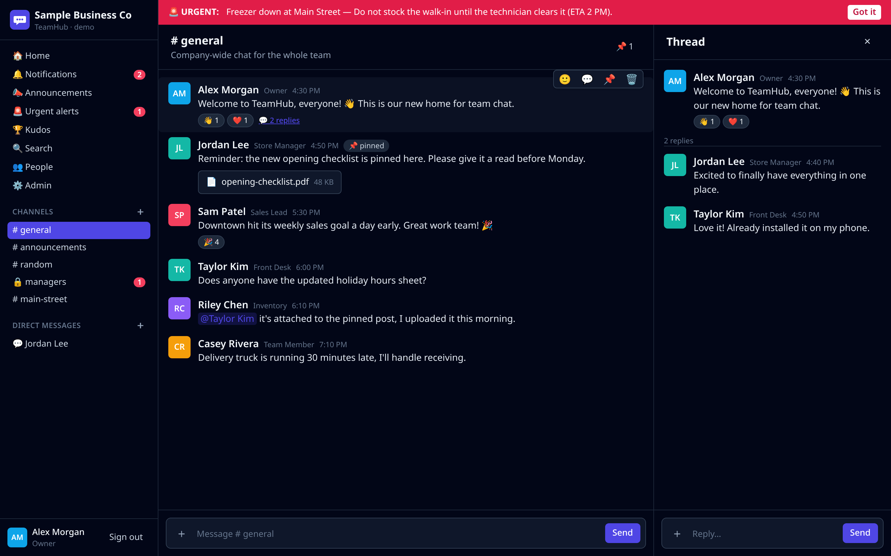
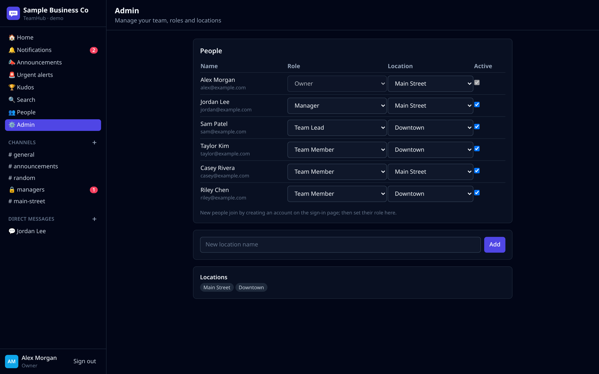
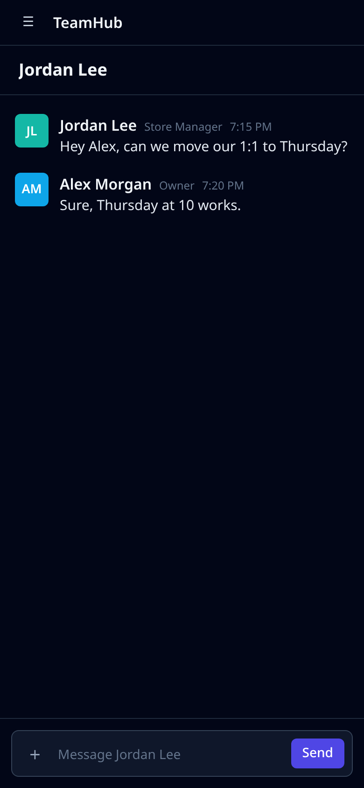

# TeamHub

**Open-source, self-hostable team chat for small businesses.** Restaurants, shops, studios, clinics, offices, field crews: any team that wants one place to talk without paying per seat.

TeamHub gives you channels, direct messages, threads, file sharing, announcements that people have to acknowledge, urgent alerts, kudos, and an admin panel. It installs on phones as a web app (PWA). You own the data and run it on [Supabase](https://supabase.com) (free tier or self-hosted Postgres).

| Home | Channel + thread |
|---|---|
|  |  |
| **Admin** | **Mobile** |
|  |  |

*Screenshots use the built-in fictional "Sample Business Co" demo data.*

## Features

- **Channels:** public, private (invite-only), announcement (read-only for most people), and per-location channels
- **Direct messages:** 1:1 and group
- **Threads, reactions, @mentions, pinned messages, file and image attachments**
- **Announcements** with optional "please acknowledge" tracking (see who has read them)
- **Urgent alerts:** a red banner for everyone until each person taps "Got it", with acknowledgement counts
- **Kudos:** a team recognition feed
- **Notifications:** mentions, DMs, thread replies, reactions, announcements and alerts, with unread badges
- **Search** across everything you're allowed to see
- **People directory** with roles, titles and locations
- **Admin panel:** change roles, deactivate people, add locations
- **Roles and permissions:** Owner > Admin > Team Lead > Manager > Member, enforced in the database with Row Level Security (not just hidden in the UI)
- **Realtime:** new messages appear instantly (Supabase Realtime)
- **Installable PWA:** works on iPhone, Android and desktop with "Add to Home Screen"
- **Demo mode:** try the whole app in your browser with no backend at all
- **One place for branding:** app name, company name, colour and labels

## Try it in 30 seconds (no backend)

```bash
git clone https://github.com/robdilella-apps/teamhub.git
cd teamhub
npm install
npm run demo          # opens http://localhost:5173 with sample data
```

Sign in as `alex@example.com` (owner), `jordan@example.com` (manager) or `taylor@example.com` (member). The password is `teamhub-demo`. Demo data lives only in your browser's localStorage.

## Self-host with Supabase (local)

Requirements: Node 20+, and Docker (for the Supabase local stack).

```bash
npm install
npx supabase start    # starts Postgres, Auth, Realtime and Storage locally, then applies the migration and seed
npm run setup         # writes .env with your local Supabase URL + anon key
npm run dev           # http://localhost:5173
```

The seed creates the fictional **Sample Business Co** (2 locations, 6 people, sample channels, messages, an announcement and an urgent alert). Every seeded user's password is `teamhub-demo`. To start from a clean slate for your own team, delete `supabase/seed.sql` (or keep only its roles, locations and channels sections) and run `npx supabase db reset`. **The first account that signs up on an empty database becomes the Owner.**

Supabase Studio (database admin UI) runs at http://localhost:54323.

## Deploy to production

1. Create a project at [supabase.com](https://supabase.com). Free is fine to start.
2. Apply the schema: `npx supabase link --project-ref <your-ref>` then `npx supabase db push`. Alternatively, paste `supabase/migrations/*.sql` into the SQL editor.
3. In **Authentication → Providers**, keep Email enabled. In **URL Configuration**, set your site URL.
4. Host the frontend anywhere that serves static files (Netlify, Vercel, Cloudflare Pages, or any web server):
   ```bash
   VITE_SUPABASE_URL=https://<ref>.supabase.co VITE_SUPABASE_ANON_KEY=<anon key> npm run build   # outputs dist/
   ```
   A `netlify.toml` is included. Set the two variables in your host's dashboard and never commit them.
5. Open the site and sign up. The first person becomes the Owner and can promote others under **Admin**.

## Make it yours

Edit `src/brand.ts`, or set these in `.env`:

| Variable | Default | What it does |
|---|---|---|
| `VITE_APP_NAME` | `TeamHub` | App name (title bar, sign-in, PWA install name) |
| `VITE_COMPANY_NAME` | `Sample Business Co` | Your business name in the sidebar |
| `VITE_TAGLINE` | `Team chat for your business` | Sign-in screen tagline |
| `VITE_BRAND_COLOR` | `#4f46e5` | Accent colour |
| `VITE_LOCATION_LABEL` | `Location` | What you call a site: "Store", "Restaurant", "Office"… |

Replace `public/logo.svg` with your logo. Roles, locations, departments and default channels are plain rows in the database: edit them in Supabase Studio or in `supabase/seed.sql`.

## Project layout

```
src/
  brand.ts                 all branding in one place
  lib/types.ts             Backend interface (what the UI needs)
  lib/supabaseBackend.ts   Supabase implementation (Postgres + Auth + Realtime + Storage)
  lib/demoBackend.ts       in-browser demo implementation with sample data
  components/, pages/      React UI (Tailwind)
supabase/
  migrations/              schema, triggers, Row Level Security, RPCs, storage, realtime
  seed.sql                 fictional Sample Business Co data
tests/                     database RLS tests + browser smoke test
```

**Stack:** React 18, TypeScript, Vite, Tailwind CSS, vite-plugin-pwa, Supabase (Postgres, Auth, Realtime, Storage).

## Testing

```bash
npm run build                 # type-check + production build
npm run test:db               # applies migration + seed to a scratch Postgres DB and checks permissions (needs psql + PG* env vars)
npx vite build --mode demo --outDir demo-dist && npx vite preview --outDir demo-dist --port 4173 &
python3 tests/e2e_demo.py     # Playwright browser smoke test
```

A ready-made GitHub Actions workflow is in `docs/ci-workflow.yml`. Copy it to `.github/workflows/ci.yml` to run all three on every push.

## Roadmap

Web push notifications, email/SMS notification hooks, message editing, channel member management UI, bots/webhooks API, data export, and optional native wrappers.

## License

[MIT](LICENSE). Use it, change it, sell it, run it for your own team.
